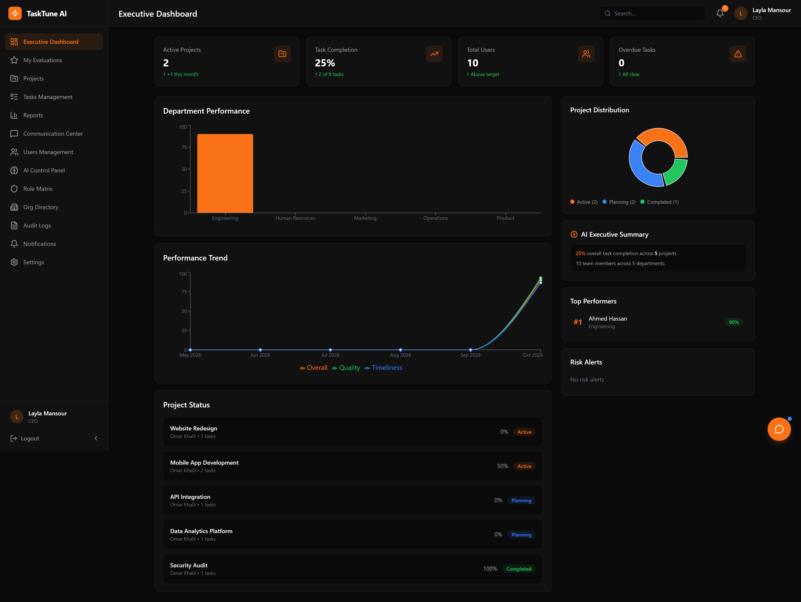
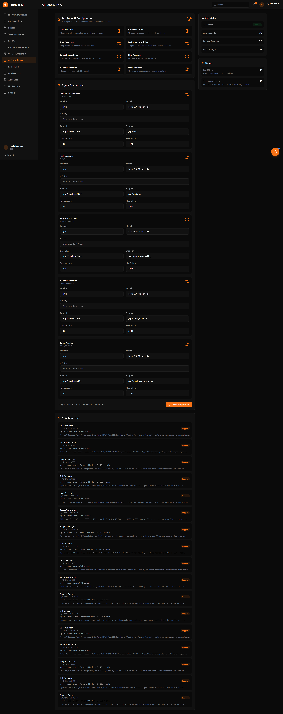
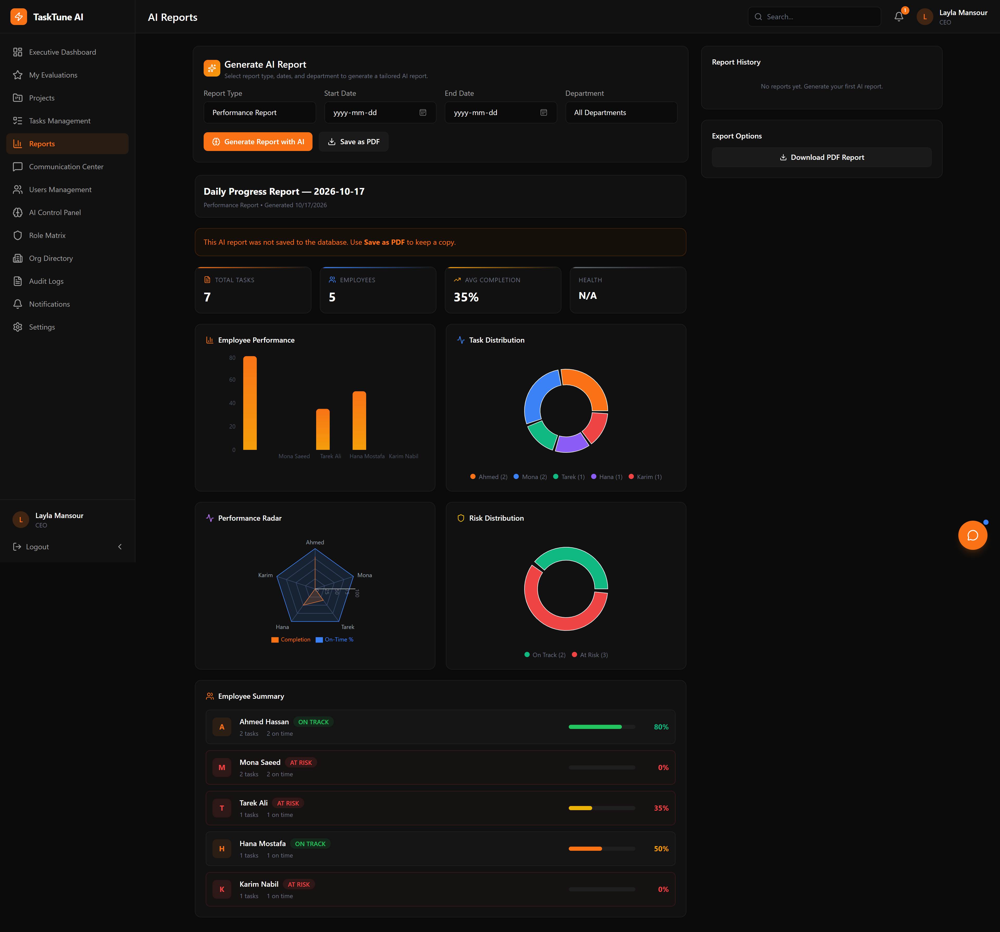
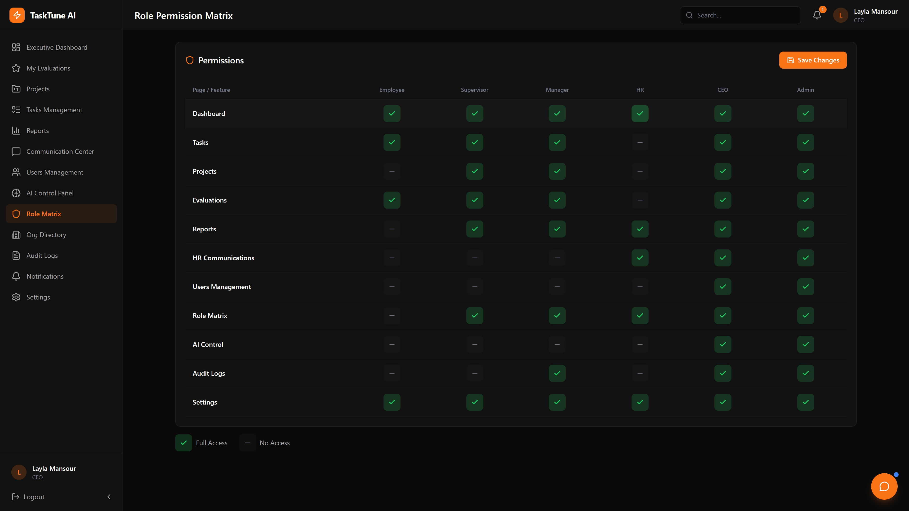

# TaskTune AI

TaskTune AI is an integrated Work & HR Management System that combines project management, task tracking, performance evaluation, reporting, communication, and AI-powered insights.

## Overview

The platform is designed for six main roles:

- Employee
- Supervisor
- Manager
- CEO
- HR
- Admin

TaskTune AI centralizes workflows across tasks, projects, evaluations, dashboards, communications, and AI assistance in one system.

## 🎬 Live Demonstration & Real Interface

[](docs/assets/demo.mp4)

> 📹 **High-Definition 1080p MP4 Demo Recording**: [`docs/assets/demo.mp4`](docs/assets/demo.mp4)

### 📸 Visual Feature Gallery

| 1. Executive Dashboard & Role Overview | 2. Studio / Interactive Workbench |
|:---:|:---:|
|  |  |
| **3. Project Analytics & Progress** | **4. AI Agent Telemetry & Tasks** |
|  |  |

---

### ⚡ 1-Click Launch (Windows Standalone)

Run the included standalone launcher to boot the database, .NET API, Python AI agents swarm, and web UI immediately:

```bat
.\run.bat
```

---

## Current Status & Live Architecture

The full stack is fully implemented and operational:

- **Frontend**: React 19 + Vite + Tailwind CSS running on port `http://localhost:3000`
- **Backend Web API**: ASP.NET Core 8 Web API compiled and running on `http://localhost:5000` with Swagger UI at `http://localhost:5000/swagger`
- **Database**: Microsoft SQL Server 2025 Express (`TaskTuneAIDatabase`) with all 23 relational tables active, migrated, and seeded
- **Multi-Agent Swarm**: 5 specialized AI agents orchestrated in Python with live Groq LLM inference (`qwen/qwen3.8-27b`) running on port `http://localhost:8000`
- **Standalone Runner**: `run.bat` automatically verifies SQL Server connectivity, launches the backend API, spins up the 5 AI agents, and serves the UI


## Tech stack

### Frontend
- React 19
- Vite
- Tailwind CSS v4
- Recharts
- Lucide React
- React Router
- Axios
- TanStack Query
- Zustand
- React Hook Form
- Zod
- i18next
- SignalR client

### Backend
- ASP.NET Core 8 Web API
- Entity Framework Core 8
- SQL Server 2022
- JWT Authentication
- FluentValidation
- AutoMapper
- Serilog
- Polly
- Swagger / OpenAPI
- SignalR
- QuestPDF

### Infrastructure
- SQL Server
- Redis
- Local file storage for development
- Azure Blob Storage for production
- GitHub Actions
- Docker Compose

### AI
- Azure OpenAI / OpenAI integration
- 5 specialized AI agents:
  - Chatbot
  - Task Guidance
  - Progress Tracking
  - Email / Communication
  - Feedback / Reports

## Monorepo structure

```text
tasktune-ai/
├── tasktune-frontend/
├── tasktune-backend/
├── tasktune-video/
├── docs/
├── .github/workflows/
├── docker-compose.yml
└── README.md
```
