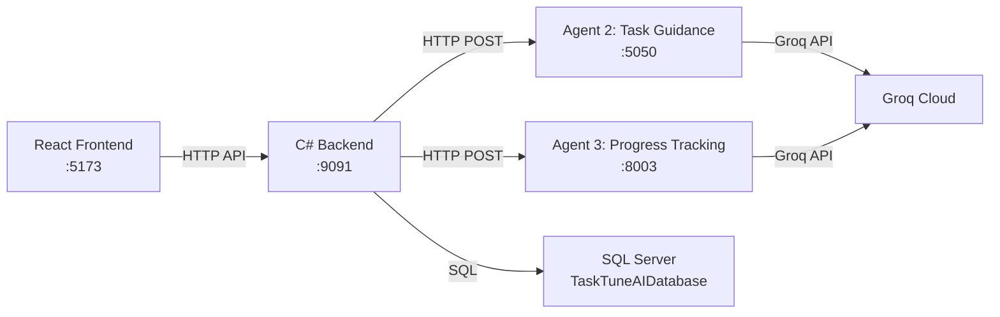

# TaskTune — Complete Project Run & Test Guide

> [!IMPORTANT]
> You need **4 terminals** running simultaneously. The project has 3 independent services + a database.

---

## Architecture Overview



| Service | Tech | Port | Directory |
|---------|------|------|-----------|
| Frontend | React + Vite + Tailwind | `5173` | `tasktune-frontend/` |
| Backend API | ASP.NET (Framework 4.8) | `9091` | `tasktune-backend/TaskTuneAPI/` |
| Agent 2 – Task Guidance | Python FastAPI + LangGraph | `5050` | `tasktune-agents/agent2_task_guidance/` |
| Agent 3 – Progress Tracking | Python FastAPI + LangGraph | `8003` | `tasktune-agents/agent3_progress_tracking/` |
| Database | SQL Server | default | `TaskTuneAIDatabase` |

---

## Prerequisites

- **Node.js** ≥ 18 (`node --version`)
- **Python** ≥ 3.10 (`python --version`)
- **Visual Studio** 2022 (for the .NET Framework 4.8 backend) or IIS Express
- **SQL Server** (LocalDB or full, with the `TaskTuneAIDatabase` created)
- **Groq API Key** from [Groq Console](https://console.groq.com/keys)

---

## Step 0 — One-Time Setup

### Database
If the database doesn't exist yet, run the setup script in SQL Server Management Studio:

```
File: tasktune-backend/Script Database/setup_database.sql
```

### Python Dependencies

```powershell
cd "D:\Personal\Courses\Agentic AI - NTI\Final Project\files\tasktune-agents"
pip install -r requirements.txt
```

### Frontend Dependencies

```powershell
cd "D:\Personal\Courses\Agentic AI - NTI\Final Project\files\tasktune-frontend"
npm install
```

### API Key
Create the `.env` file in the agents root:

```powershell
# File: tasktune-agents/.env
GROQ_API_KEY=your-groq-api-key-here
```

---

## Step 1 — Start the Backend (Terminal 1)

Open the solution in **Visual Studio**:

```
File: tasktune-backend/TaskTuneAPI/TaskTuneAPI.csproj
```

Press **F5** or **Ctrl+F5** to run. The API will start on `http://localhost:9091`.

> [!NOTE]
> The connection string in [Web.config](file:///D:/Personal/Courses/Agentic%20AI%20-%20NTI/Final%20Project/files/tasktune-backend/TaskTuneAPI/Web.config) points to SQL Server instance `KERO`. Update it to match your machine's SQL Server instance name if different.

---

## Step 2 — Start the AI Agents (Terminal 2)

> [!TIP]
> The easiest way is to use the bundled launcher that starts **both** agents at once:

```powershell
cd "D:\Personal\Courses\Agentic AI - NTI\Final Project\files\tasktune-agents"
python start_all_agents.py
```

This starts:
- **Agent 2 (Task Guidance)** → `http://localhost:5050`
- **Agent 3 (Progress Tracking)** → `http://localhost:8003`

**Or start each agent individually** (in separate terminals):

```powershell
# Terminal 2a — Task Guidance Agent
cd "D:\Personal\Courses\Agentic AI - NTI\Final Project\files\tasktune-agents"
python -m uvicorn agent2_task_guidance.server:app --port 5050

# Terminal 2b — Progress Tracking Agent
cd "D:\Personal\Courses\Agentic AI - NTI\Final Project\files\tasktune-agents"
python -m uvicorn agent3_progress_tracking.main:app --port 8003
```

---

## Step 3 — Start the Frontend (Terminal 3)

```powershell
cd "D:\Personal\Courses\Agentic AI - NTI\Final Project\files\tasktune-frontend"
npm run dev
```

Open the browser at **http://localhost:5173**.

---

## Verifying Everything is Running

### Quick Health Checks

Open these URLs in a browser or use `curl`:

| Check | URL | Expected |
|-------|-----|----------|
| Backend alive | `http://localhost:9091/api/tasks` | `401 Unauthorized` (auth needed, but proves server is up) |
| Agent 2 health | `http://localhost:5050/api/health` | `{"status":"ok","agent":"task_guidance"}` |
| Agent 2 docs | `http://localhost:5050/docs` | Swagger UI |
| Agent 3 health | `http://localhost:8003/api/health` | Health response |
| Agent 3 docs | `http://localhost:8003/docs` | Swagger UI |
| Frontend | `http://localhost:5173` | React app loads |

---

## Testing the AI Agents

### Test 1: Agent 2 — Direct API Test (no auth needed)

```powershell
# PowerShell — call the agent API directly:
$body = @{
    task_name = "Build User Dashboard"
    description = "Create a dashboard showing KPIs, task progress, and team metrics"
    subtasks = @()
    definition_of_done = "Dashboard loads in under 2 seconds with real-time data"
    due_date = "2026-04-15"
    dependencies = @()
    industry = "Technology"
    user_role = "Manager"
    completion_percentage = 0
} | ConvertTo-Json

Invoke-RestMethod -Uri "http://localhost:5050/api/guidance" -Method Post -Body $body -ContentType "application/json"
```

### Test 2: Agent 2 — Interactive Demo (CLI)

```powershell
cd "D:\Personal\Courses\Agentic AI - NTI\Final Project\files\tasktune-agents"

# Run with pre-built sample tasks:
python -m agent2_task_guidance.demo

# Or enter your own task:
python -m agent2_task_guidance.demo --custom
```

### Test 3: Through the Frontend (End-to-End)

1. Open `http://localhost:5173` and log in
2. Navigate to **Tasks Management**
3. Click **Create Task** — fill in a task name and description
4. Click the **✨ AI Recommend** / **Generate Guidance** button
5. The frontend calls the C# backend → which calls Agent 2 → which calls Groq
6. You should see AI-generated guidance, subtasks, risk assessment, etc.

### Test 4: Agent 3 — Progress Tracking (Swagger)

1. Open `http://localhost:8003/docs`
2. Try the available endpoints with sample payloads

---

## Troubleshooting

| Problem | Solution |
|---------|----------|
| `[Errno 10048] port already in use` | Another instance is already running on that port. Kill it: `netstat -ano \| findstr :5050` then `taskkill /PID <pid> /F` |
| `503 UNAVAILABLE` from Groq | Temporary API overload — the SDK retries automatically. Just wait |
| `GROQ_API_KEY is not set` | Create `tasktune-agents/.env` with `GROQ_API_KEY=your-key` |
| `Agent API unreachable` | Start the agent server first (Step 2) before using the frontend |
| Frontend shows network error | Make sure the C# backend is running on port `9091` |
| SQL connection error | Check `Web.config` connection string matches your SQL Server instance |

---

## Stopping Everything

- **Agents**: Press `Ctrl+C` in the terminal running `start_all_agents.py`
- **Frontend**: Press `Ctrl+C` in the Vite terminal
- **Backend**: Stop debugging in Visual Studio

---

## Quick Reference — All Commands

```powershell
# ── AGENTS (Terminal 1) ──────────────────────────────────
cd "D:\Personal\Courses\Agentic AI - NTI\Final Project\files\tasktune-agents"
python start_all_agents.py

# ── FRONTEND (Terminal 2) ────────────────────────────────
cd "D:\Personal\Courses\Agentic AI - NTI\Final Project\files\tasktune-frontend"
npm run dev

# ── BACKEND (Terminal 3 / Visual Studio) ─────────────────
# Open TaskTuneAPI.csproj in Visual Studio → F5

# ── DEMO (any terminal) ─────────────────────────────────
cd "D:\Personal\Courses\Agentic AI - NTI\Final Project\files\tasktune-agents"
python -m agent2_task_guidance.demo
```
